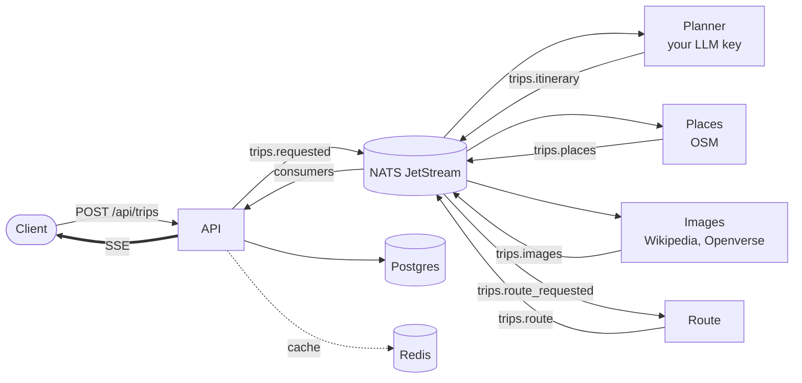

# Trequila

**An open-source, bring-your-own-key AI trip planner API.** Describe a trip, and Trequila generates a
day-by-day itinerary, finds real nearby places and destination images, orders each day's stops, and streams
the results to you as they arrive.

[](LICENSE)


> **Status: pre-1.0.** The API works end to end today. Trequila is being rebuilt into a *grounded, editable*
> planner (itineraries built only from verified OpenStreetMap places, checked against opening hours and real
> travel times) on an event-driven, multi-service architecture. The plan and progress live in
> [`docs/design/2026-10-22-trequila-refocus-design.md`](docs/design/2026-10-22-trequila-refocus-design.md).

## What it does

- **Itinerary generation** with the LLM you choose: Google Gemini, Anthropic Claude, or any
  OpenAI-compatible endpoint. Keys are yours, stored encrypted (AES-256-GCM), and never returned by the API.
- **Keyless enrichment**: geocoding and places from OpenStreetMap (Nominatim and Overpass), images from
  Wikipedia and Openverse. No third-party API keys to self-host.
- **Live progress over Server-Sent Events**: images, places, the itinerary and the route stream in as each
  stage finishes.
- **Route ordering**: each day's stops are ordered by clock time or by shortest path.
- **MCP server** (`/mcp`) so AI clients can create and read trips, and an **agentic chat** endpoint.

## Quickstart (Docker)

You need Docker with the Compose plugin. Nothing else.

```bash
git clone https://github.com/Sky-walkerX/Trequila.git
cd Trequila
make env     # writes .env with freshly generated local secrets and DB password
make up      # builds the API and starts Postgres, NATS JetStream and Redis
curl localhost:8080/health
```

Then try it:

```bash
# 1. Register and keep the token
TOKEN=$(curl -s localhost:8080/auth/register -H 'content-type: application/json' \
  -d '{"email":"you@example.com","password":"a-long-password","name":"You"}' | jq -r .token)

# 2. Store your own LLM key (encrypted at rest)
curl -s localhost:8080/api/keys -H "Authorization: Bearer $TOKEN" -H 'content-type: application/json' \
  -d '{"provider":"gemini","api_key":"YOUR_KEY","default_model":"gemini-2.5-flash","make_default":true}'

# 3. Plan a trip, then watch it build
ID=$(curl -s localhost:8080/api/trips -H "Authorization: Bearer $TOKEN" -H 'content-type: application/json' \
  -d '{"source":"Berlin","destination":"Lisbon","start_date":"2026-12-01","end_date":"2026-12-04","interests":["food","history"]}' | jq -r .request_id)
curl -N localhost:8080/api/trips/stream/$ID -H "Authorization: Bearer $TOKEN"
```

`make help` lists the other targets (`logs`, `psql`, `down`, `reset`, `test`, `check`). The full HTTP
reference is [`API_DOCUMENTATION.md`](API_DOCUMENTATION.md).

## Architecture

One Go binary runs the HTTP API and the workers as goroutines. They talk only through a NATS JetStream
stream (`TRIPS`), so each worker can later be deployed on its own.



More detail, conventions and gotchas for contributors are in [`CLAUDE.md`](CLAUDE.md).

## Configuration

`make env` generates the two required secrets for local use. In production set these yourself.

| Variable | Required | Purpose |
|---|---|---|
| `DATABASE_URL` | yes | Postgres connection string |
| `REDIS_URL` | yes | Redis address (`host:port`, or a `rediss://` URL) |
| `NATS_URL` | yes | NATS server with JetStream enabled |
| `JWT_SECRET` | yes | JWT signing key, at least 32 bytes; the server refuses to start otherwise |
| `ENCRYPTION_KEY` | yes | 32-byte base64 key for AES-256-GCM. **Losing it makes every stored user key unreadable** |
| `CORS_ALLOWED_ORIGINS` | no | Comma-separated browser origins allowed to call the API |
| `FRONTEND_URL` | no | Where the Google OAuth callback redirects |
| `GOOGLE_CLIENT_ID`, `GOOGLE_CLIENT_SECRET`, `GOOGLE_REDIRECT_URL` | no | Enable Google sign-in |
| `OSM_NOMINATIM_URL`, `OSM_OVERPASS_URL`, `WIKIPEDIA_API_URL`, `OPENVERSE_API_URL`, `HTTP_USER_AGENT` | no | Point enrichment at your own mirrors |

[`.env.example`](.env.example) documents every variable, including Redis TLS options.

## Development

```bash
make check          # gofmt, go vet and the test suite: what CI runs
go test ./internal/crypto -run TestEncryptDecryptRoundTrip -v   # one test
```

The test suite needs no external services. See [`CONTRIBUTING.md`](CONTRIBUTING.md) for the workflow.

## Security

Report vulnerabilities privately; see [`SECURITY.md`](SECURITY.md) for the process and the key-custody model.

## License

[Apache License 2.0](LICENSE).
